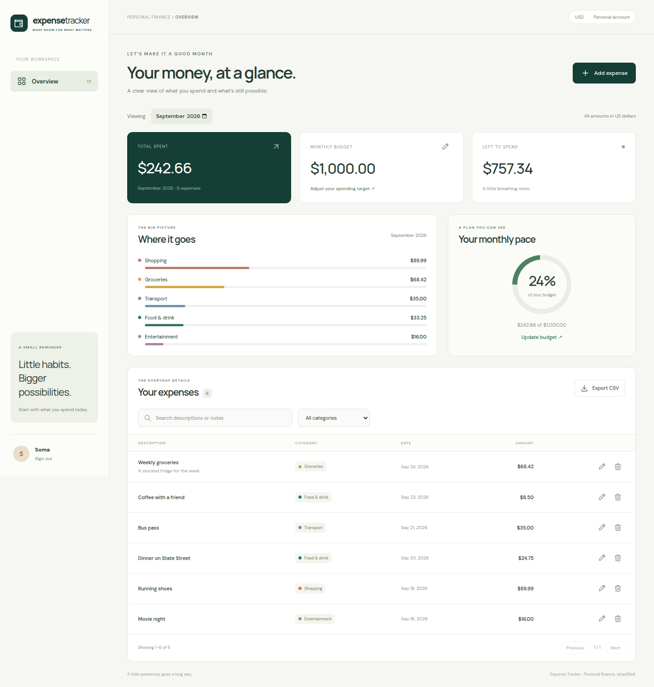
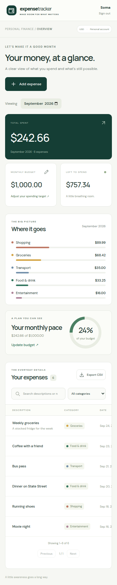

# Expense Tracker

A personal expense tracker built with React, Node.js, Express, and MongoDB.
Record daily spending, set a monthly target, and see where your money goes.

## Implemented features

- Sign up, sign in, persistent sessions, and sign out.
- Create, edit, and delete private expense records with dates, categories, and notes.
- A monthly spending target with remaining/over-budget totals.
- Monthly category breakdowns and budget progress.
- Month selection, description/note search, category filtering, and table pagination.
- CSV export of the current filtered results.
- Responsive desktop/mobile interface, validation messages, and empty/loading states.

## Screenshots

Screenshots use fictional records in a disposable test account.



<details>
<summary>Mobile dashboard</summary>



</details>

## Run locally

Requirements: Node.js 24, npm, and MongoDB (local installation, Docker, or Atlas).

```sh
git clone https://github.com/somaditya1/expense-tracker.git
cd expense-tracker
npm ci
cp .env.example .env
```

For a local database using Docker:

```sh
docker compose up -d mongo
```

Alternatively, start your local MongoDB service or set `MONGODB_URI` in `.env`
to an Atlas connection string including the database name. Then run:

```sh
npm run dev
```

Open **http://localhost:5173**. Create an account with a password of at least
10 characters. There is no preconfigured account or shared demo password.

The frontend runs on port 5173 and proxies `/api` to the server on port 3001.
For these defaults, keep `PORT=3001` and `APP_ORIGIN=http://localhost:5173`.

## Configuration

| Variable      | Purpose                                                 | Default/example                                   |
| ------------- | ------------------------------------------------------- | ------------------------------------------------- |
| `MONGODB_URI` | Required persistent database connection                 | `mongodb://127.0.0.1:27017/expense_tracker`       |
| `PORT`        | Express listener                                        | `3001`                                            |
| `APP_ORIGIN`  | Exact allowed browser origin; production requires HTTPS | `http://localhost:5173`                           |
| `NODE_ENV`    | Enables production Secure cookies                       | `development` locally; `production` on a host     |
| `TRUST_PROXY` | Trust exactly one reverse proxy, when applicable        | Unset locally; `1` only for a matching deployment |

Keep real credentials in environment variables. `.env` files are excluded from Git.

## Build and test

```sh
npm run check
npx playwright install chromium
npm run test:e2e
```

`npm run check` checks formatting, runs 15 domain/API tests, builds the frontend,
and smoke-tests the real production entry point and compiled assets.
API tests use a real, isolated MongoDB process via `mongodb-memory-server`.
The first run downloads a MongoDB binary; production never uses that test database.

Two Chromium browser tests cover signup/login, expense CRUD, budget updates,
refresh persistence, filters, export, logout, mobile overflow, and dialog focus.
The screenshot test regenerates the screenshots above. Browser tests start
their own frontend/API services, so ports 5173 and 3001 must be free.

GitHub Actions is configured to run the checks and browser tests on pushes and
pull requests. Workflow configuration alone is not evidence of a successful run;
see the repository's Actions tab for actual results.

## Production

```sh
npm run build
npm start
```

Express serves the compiled frontend and API from one origin. A persistent
MongoDB connection and HTTPS are required for production.
See [deployment instructions](docs/DEPLOYMENT.md) for hosting configuration
and post-deployment checks. **No public live deployment is claimed here.**

## API

All mutation requests require `Content-Type: application/json`. Authentication
uses an HttpOnly cookie. Expense amounts and budgets are submitted as decimal
USD strings and returned as integer cents.

| Method | Route                | Behavior                   | Authentication |
| ------ | -------------------- | -------------------------- | -------------- |
| GET    | `/api/health`        | Database readiness         | No             |
| POST   | `/api/auth/register` | Create account and session | No             |
| POST   | `/api/auth/login`    | Start session              | No             |
| POST   | `/api/auth/logout`   | Revoke current session     | Optional       |
| GET    | `/api/auth/me`       | Current account and budget | Yes            |
| PATCH  | `/api/budget`        | Set/reset monthly target   | Yes            |
| GET    | `/api/expenses`      | List own expenses          | Yes            |
| POST   | `/api/expenses`      | Create own expense         | Yes            |
| PATCH  | `/api/expenses/:id`  | Replace own expense fields | Yes            |
| DELETE | `/api/expenses/:id`  | Delete own expense         | Yes            |

Example expense body:

```json
{
  "description": "Weekly groceries",
  "amount": "68.42",
  "category": "Groceries",
  "date": "2026-09-29",
  "note": "Sample expense"
}
```

Register accepts `name`, `email`, and `password`; login accepts `email` and
`password`. Budget updates accept `{"amount":"1000.00"}`; `"0"` removes the target.
Errors return an HTTP status and `{"error":"Readable message"}`.

## Technical decisions

- **Integer cents:** exact decimal parsing avoids floating-point money errors.
- **Server-side ownership:** database queries enforce account isolation.
- **Opaque sessions:** random tokens in HttpOnly cookies; token hashes and
  expiration in MongoDB; salted scrypt password hashes.
- **Same-origin deployment:** one service serves React and Express, simplifying
  browser requests and cookie configuration.

See [architecture and tradeoffs](docs/ARCHITECTURE.md) for details and
[project/interview notes](docs/PROJECT_NOTES.md) for evidence and next steps.

## Known limitations

- USD only; manual expense entry; no bank connection or income tracking.
- One reusable monthly budget target rather than historical per-month targets.
- All account expenses are loaded before browser filtering/pagination.
- No password reset, email verification, or account deletion flow yet.
- Authentication rate limiting uses an in-process store for one server instance.
- No claim of user adoption, production operation, or a complete security/accessibility audit.
